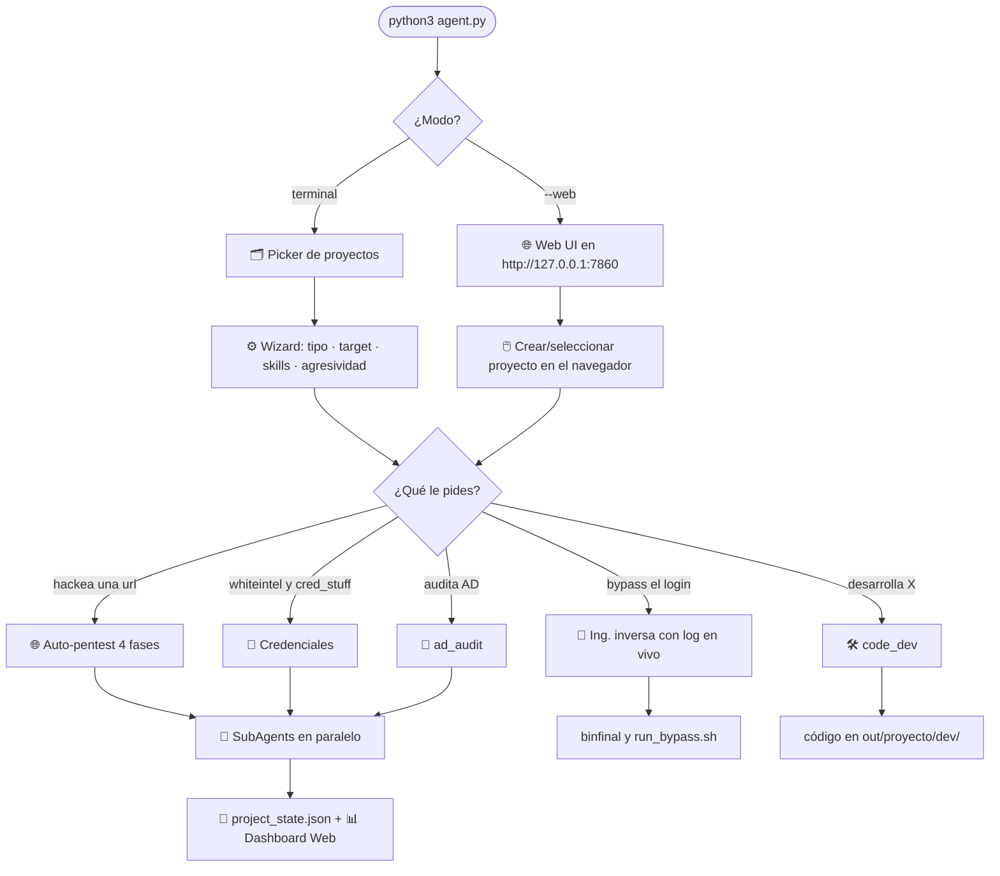
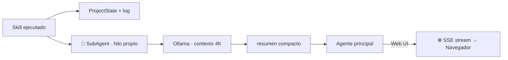

<div align="center">


<br/>


</div>

<div align="center">

### 🧠 IA local (Ollama) · ⚡ 22 skills · 🌐 Web UI · 🔬 RE + bypass · 🕸️ web dinámico · 🔑 credential intel · 🛠️ dev de código

</div>

> ### ⚠️ AVISO LEGAL
> Uso **exclusivo** en sistemas con **autorización expresa y por escrito** del propietario.
> El uso no autorizado es delito · *Art. 197 bis CP (España)* · *CFAA (USA)* · *Ley 1273 (Colombia)*.
> **Audita solo lo que te pertenece o tienes permiso de auditar.**

---

## ✨ ¿Qué es?

**HackerAgent** es un agente de terminal/web que orquesta **modelos locales de Ollama** para hacer pentesting, ingeniería inversa, **auditoría de Active Directory** y desarrollo de herramientas ofensivas — **sin enviar nada a la nube**. Tú describes el objetivo en lenguaje natural (o desde el navegador con la nueva **Web UI**) y el agente ejecuta los *skills* adecuados, analiza los resultados con **sub-agentes en paralelo** y te entrega hallazgos, PoCs, binarios bypasseados o código, todo organizado por proyecto.

<div align="center">

| 🎯 | Capacidad | 
|:---:|:---|
| 🕸️ | **Pentest web dinámico** — crawlea y prueba SQLi / XSS / LFI / redirect / cmdi en vivo |
| 💉 | **SQL injection** — detecta y **extrae** datos con sqlmap (o fallback manual) |
| 🔑 | **Credential intel** — descarga credenciales filtradas (WhiteIntel) y las **prueba** contra el login |
| 🔬 | **Ingeniería inversa** — scripts, binarios y KeyAuth; bypass de login con **log en vivo** |
| 🛠️ | **Desarrollo de código** — genera payloads/malware/exploits con el mejor modelo local |
| 🤖 | **Multi-agente** — cada skill lanza un SubAgent que analiza en paralelo con contexto propio |
| 💾 | **Persistencia** — dominios, hallazgos y sesiones se acumulan por proyecto |
| 📊 | **Reportes** — HTML dark-theme con gráficos + Markdown |
| 🌐 | **Web UI** — interfaz gráfica con chat, proyectos, skills y dashboard de vulnerabilidades |
| 🏢 | **AD Audit** — escanea DCs y audita LDAP, SMB, Kerberos y más |

</div>

---

## 🌐 Web UI — `python agent.py --web`

> **NUEVO** — Interfaz web completa tipo Claude, sin instalar nada extra (Flask se instala solo).

```bash
python agent.py --web              # http://127.0.0.1:7860 (abre navegador automáticamente)
python agent.py --web --port 8080  # puerto personalizado
python agent.py --web --host 0.0.0.0 --port 7860  # accesible desde la LAN
```

<div align="center">

| Feature | Descripción |
|:--------|:------------|
| 💬 **Chat en tiempo real** | Streaming token a token desde Ollama (igual que Claude) |
| 📁 **Multi-proyecto** | Crea proyectos, especifica carpeta del SO, gestiona desde el navegador |
| 🗨️ **Multi-chat** | Varias sesiones de conversación por proyecto, historial persistente |
| ⚙️ **Toggle de skills** | Activa/desactiva skills por sesión con interruptores visuales |
| 📊 **Dashboard** | Tarjetas por severidad + tabla filtrable de hallazgos + subdominios |
| 📎 **Upload de archivos** | Sube archivos y se inyectan en el contexto del agente |
| 🤖 **Selector de modelos** | Lista de modelos Ollama con ranking automático |
| ⌨️ **Historial** | Ver comandos ejecutados con output expandible |

</div>

---

## 🗺️ Cómo funciona



---

## 🚀 Instalación

```bash
# 1) Copiar el proyecto a la máquina (Kali recomendado)
cd /opt && cp -r /media/sf_CarpetaCompartida/tools/HackerAgent . && cd HackerAgent

# 2) Dependencias Python
pip3 install requests

# 3) Ollama (local o en otra VM)
curl -fsSL https://ollama.com/install.sh | sh
ollama pull deepseek-r1:14b        # razonamiento / pentest
ollama pull dolphin-mistral        # sin censura / desarrollo ofensivo

# 4) Configurar .env  (ver abajo)
nano .env

# 5) Ejecutar en modo terminal
python3 agent.py

# 6) Ejecutar en modo Web (Flask se instala automáticamente)
python3 agent.py --web
```

---

## 🔧 Configuración — `.env`

```env
OLLAMA_URL="http://192.168.80.120:11434/api/chat"

WPSCAN_API_KEY=""        # https://wpscan.com/api  (gratis, 25 req/día)
SHODAN_API_KEY=""        # https://account.shodan.io
VIRUSTOTAL_API_KEY=""    # https://www.virustotal.com/gui/user/apikey
WHITEINTEL_API_KEY=""    # https://whiteintel.io  (stealer logs)

BROWSER="firefox"
```

> Las API keys también se piden durante la sesión cuando hacen falta y se guardan solas en `.env`.

---

## 🧩 Skills (22)

<div align="center">

| Skill | Categoría | Qué hace |
|:------|:---------:|:---------|
| `crtsh_enum` | 🔍 recon pasivo | Subdominios vía Certificate Transparency |
| `google_dorks` | 🔍 recon pasivo | Google dorks de seguridad |
| `shodan_query` | 🔍 recon pasivo | Shodan API + InternetDB fallback |
| `subfinder_enum` | 🔍 recon pasivo | Subfinder + verificación HTTP (httpx) |
| `whiteintel` | 🔍 recon pasivo | Descarga credenciales filtradas de stealer logs |
| `whiteintel_num` | 🔍 recon pasivo | API WhiteIntel.io — consulta creds expuestas por dominio/empresa |
| `gobuster_dir` | ⚡ recon activo | Fuzzing de directorios (auto-retry wildcard 403) |
| `scan_red` | ⚡ recon activo | Nmap con clasificación de puertos críticos |
| `nuclei_scan` | 🎯 vuln scan | Nuclei con auto-detección de templates + JSON |
| `wpscan_run` | 🎯 vuln scan | WPScan con API key automática |
| `sqli_scan` | 🎯 vuln scan | Detecta **y extrae** SQLi con sqlmap (+ fallback) |
| `web_attack` | 🎯 vuln scan | Pentest web dinámico: SQLi/XSS/LFI/redirect/cmdi |
| ✨ `ad_audit` | 🎯 vuln scan | **AD Scanner**: LDAP anónimo, SMB signing, Kerberos, LDAPS, GC |
| `spider_code` | 🔬 análisis | Spider HTML/JS: secretos, creds, source maps |
| `web_code` | 🔬 análisis | Análisis profundo: framework, Firebase, endpoints, GraphQL |
| `ing_inversa` | 🔬 ing. inversa | RE + bypass (scripts, binarios, carpetas, KeyAuth) |
| `metasploit` | 💥 ataque | search / exploit / auxiliary / payload / scan |
| `cred_stuff` | 💥 ataque | Prueba credenciales contra el login (bueno/malo) |
| `apk_analyze` | 📱 móvil | RE estático de APK: manifest, secretos, lógica, SSL pinning |
| `apk_dynamic` | 📱 móvil | Frida: bypass de SSL pinning + hooks de credenciales/cripto |
| `model_advisor` | 🛠️ desarrollo | Recomienda modelo Ollama **+ prepara el toolchain** del lenguaje |
| `code_dev` | 🛠️ desarrollo | Desarrolla código (pipenv + linters) → `out/<proj>/dev/` |

<sub>✨ = nuevo en esta versión</sub>

</div>

---

## 🏢 Active Directory Audit — `ad_audit`

> Skill v2.1 — escaneo **paralelo**, sin herramientas externas, auto-instala dependencias.

```bash
# Desde el agente (terminal o web)
SKILL:ad_audit target=192.168.1.10
SKILL:ad_audit target=corp.local
SKILL:ad_audit target=10.10.0.0/24 timeout=1.5 threads=50
```

<div align="center">

| Check | Severidad si falla | Descripción |
|:------|:------------------:|:------------|
| **LDAP Anonymous Search** | 🟠 Alto | Enumerar usuarios sin credenciales |
| **LDAP Signing not required** | 🟡 Medio | NTLM/LDAP Relay posible |
| **LDAPS Certificate** | 🔵 Bajo | Self-signed o expirado |
| **SMB Signing disabled** | 🟠 Alto | SMB/NTLM Relay trivial |
| **SMB Null Session (IPC$)** | 🟠 Alto | Enumeración LSA anónima |
| **Global Catalog (3268)** | ⚪ Info | Acceso al bosque AD completo |
| **Kerberos (88)** | ⚪ Info | Vector AS-REP Roasting / Kerberoasting |

</div>

**Metodología:**
- DNS SRV lookup para auto-descubrimiento de Domain Controllers
- Escaneo de 14 puertos AD en paralelo con `ThreadPoolExecutor`
- LDAP probe con credenciales falsas → detecta si el servidor exige signing (código 8 vs 49)
- SMB2 raw socket NEGOTIATE con 3 reintentos y backoff
- Verificación de certificado LDAPS (válido / self-signed / expirado)
- Auto-install de `ldap3` y `dnspython`

---

## 🗣️ Lenguaje natural — disparadores automáticos

<div align="center">

| Escribe… | Y el agente… |
|:---------|:-------------|
| `hackea https://ejemplo.com` | ejecuta **auto-pentest** (4 fases de recon sin LLM) y pasa a explotación |
| `bypass el login de /ruta/bin` | hace **ingeniería inversa con log en vivo** y devuelve el archivo bypasseado |
| `créame un keylogger en python` | usa **code_dev** y deja el código en `out/<proyecto>/dev/` |
| `audita el servidor 10.10.0.5` | ejecuta **ad_audit** e identifica si es un DC con vulnerabilidades |
| `help` · `ayuda` · `?` | muestra **todo** lo que puede hacer, agrupado por categoría |

</div>

---

## ⚔️ Flujos ofensivos encadenados

<table>
<tr>
<td width="50%" valign="top">

**🕸️ Web**
```text
web_attack   → detecta vulns en vivo
   └─ sqli_scan (dump) → extrae la BD
```

**🔑 Credenciales**
```text
whiteintel_num  → API WhiteIntel: creds por dominio/empresa
   │              guarda JSON en out/<proj>/credentials/
whiteintel      → descarga stealer logs completos
   └─ cred_stuff → prueba cuál login funciona
```

**🏢 Active Directory**
```text
ad_audit target=corp.local
   ├─ DNS SRV  → auto-descubre DCs
   ├─ LDAP     → anon bind + signing check
   ├─ SMB      → signing + null session
   └─ Kerberos → vector AS-REP / Kerberoast
```

</td>
<td width="50%" valign="top">

**🔬 Ingeniería inversa**
```text
ing_inversa <bin|script|carpeta>
   ├─ scripts  → extrae clave + copia parcheada
   ├─ ELF      → LD_PRELOAD / patch r2
   └─ KeyAuth  → shim + Frida + servidor falso
```

**🛠️ Desarrollo**
```text
model_advisor → modelo + toolchain
   └─ code_dev → out/<proj>/dev/ (pipenv)
```

**📱 Móvil (APK)**
```text
apk_analyze <app.apk>
   └─ apk_dynamic action=ssl-unpin
        └─ apk_dynamic action=hook
```

</td>
</tr>
</table>

---

## 🤖 Modelos recomendados

<div align="center">

| Modelo | RAM | Velocidad | Ideal para |
|:-------|:---:|:---------:|:-----------|
| `deepseek-r1:14b` | 16 GB | ★★★☆ | **Recomendado** — razonamiento técnico |
| `deepseek-r1:32b` | 32 GB | ★★★☆ | Máxima profundidad de análisis |
| `dolphin-mistral` | 8 GB | ★★★★ | Desarrollo **sin censura**, payloads, CTF |
| `qwen2.5-coder` | 16 GB | ★★★★ | Código, scripts, exploits |

</div>

> `model_advisor` inspecciona tu Ollama y te dice **cuál usar** según la tarea (sin censura para ofensivo, coder/razonamiento para código).

---

## 💻 Uso

```bash
# Modo terminal (clásico)
python3 agent.py
python3 agent.py --model deepseek-r1:14b
python3 agent.py --session mi_auditoria  # carga sesión por nombre
python3 agent.py --list-sessions
python3 agent.py --no-wizard

# Modo web UI (NUEVO)
python3 agent.py --web                   # http://127.0.0.1:7860
python3 agent.py --web --port 8080
python3 agent.py --web --host 0.0.0.0   # acceso desde LAN
```

<details>
<summary><b>⌨️  Comandos dentro del agente</b> (click para desplegar)</summary>

<br/>

| Comando | Acción |
|:--------|:-------|
| `help` / `ayuda` / `?` | Muestra todo lo que el agente puede hacer |
| `listame vulnerabilidades` / `vulns` | Extrae y lista las vulns del log (numeradas) |
| `explotar <N>` | Construye y ejecuta un PoC para la vuln N |
| `reporte` / `html` | Genera reporte HTML dark-theme + Markdown |
| `apikeys` | Estado de las API keys |
| `modelo <nombre>` | Cambia el modelo de Ollama en caliente |
| `sesiones` | Lista las sesiones guardadas |
| `sesion guardar/cargar <n>` | Guarda o reanuda una sesión |
| `cd <ruta>` | Cambia el directorio de trabajo |
| `salir` / `exit` | Guarda sesión y termina |

</details>

---

## 📁 Estructura de salida

```text
out/
└── mi_proyecto/
    ├── project_state.json              ← dominios + hallazgos (acumulado entre sesiones)
    ├── scan_cache.json                 ← cache TTL 24h por comando
    ├── session_YYYYMMDD_HHMMSS.json    ← conversación completa
    ├── session_YYYYMMDD_HHMMSS.md      ← log en tiempo real
    ├── session_*_report.html           ← dark theme con gráficos
    ├── uploads/                        ← 📎 archivos subidos desde la Web UI
    ├── credentials/                    ← 🔑 whiteintel_num: JSON con creds expuestas
    │   └── whiteintel_<dominio>_<ts>.json
    └── dev/                            ← 🛠️ código generado por code_dev
out_re/
└── <binario>_TS/
    ├── binfinal / <archivo>_bypass     ← 🔬 resultado del bypass
    └── run_bypass.sh                   ← wrapper de ejecución
```

---

## 🧪 Ejemplos

```text
# Terminal
hacker ❯ hackea https://ejemplo.com
hacker ❯ enumera subdominios de banco.com y escanea con nuclei los activos
hacker ❯ SKILL:ad_audit target=corp.local
hacker ❯ SKILL:ad_audit target=10.10.0.0/24 timeout=2 threads=50
hacker ❯ SKILL:web_attack target=https://app.ejemplo.com tests=sqli,xss,lfi
hacker ❯ SKILL:whiteintel_num target=ejemplo.com company=EmpresaCorp
hacker ❯ bypass el login de /home/kali/reto/vault_bin
hacker ❯ listame vulnerabilidades
hacker ❯ explotar 3
hacker ❯ reporte
```

---

## 🛡️ Robustez del agente

| Mecanismo | Qué resuelve |
|:----------|:-------------|
| **Auto-SKILL mapping** | Si el modelo genera `subfinder -d X`, `gobuster dir -u X` o `nuclei -u X` crudos, el agente los convierte automáticamente al SKILL: equivalente antes de ejecutar |
| **Gobuster wildcard auto-retry** | Si gobuster detecta wildcard 403, reintenta solo con `--wildcard` sin que el modelo lo sepa |
| **Nuclei path fixer** | Corrige rutas relativas (`cves/`), rutas `~/nuclei-templates/*` y flags inválidos (`-categories` → `-tags`) antes de ejecutar |
| **JSON format enforcer** | Si el modelo devuelve markdown en vez de JSON, le reenvía el prompt con instrucción explícita de formato y continúa |
| **Hard truncate fallback** | Si la compresión de contexto por LLM falla (timeout), descarta los mensajes más antiguos automáticamente para que el agente nunca quede bloqueado |
| **Push-back con SKILL examples** | Cuando el modelo no emite comandos, el push-back incluye ejemplos concretos con SKILL: para el target configurado |
| **AD parallel scanner** | El skill `ad_audit` escanea 14 puertos en paralelo; si alguno falla, continúa con los demás sin interrumpir la auditoría |
| **SMB retry logic** | Hasta 3 reintentos con backoff exponencial en la negociación SMB2 |

---

<div align="center">

### 🧱 Arquitectura multi-agente

Cada skill se ejecuta *inline* (rápido) y lanza un **SubAgent** en un hilo aparte, con su propio contexto de 4K, que resume el output y devuelve `{summary, key_findings, next_step}` al agente principal — **sin contaminación cruzada** y en paralelo.



</div>

---

<div align="center">

## 📜 Licencia

**MIT** — para pentesting autorizado, CTFs, laboratorios y formación en ciberseguridad.

<br/>


<sub>Hecho para operar <b>100% local</b> · Powered by 🦙 Ollama · Úsalo con responsabilidad.</sub>

</div>
